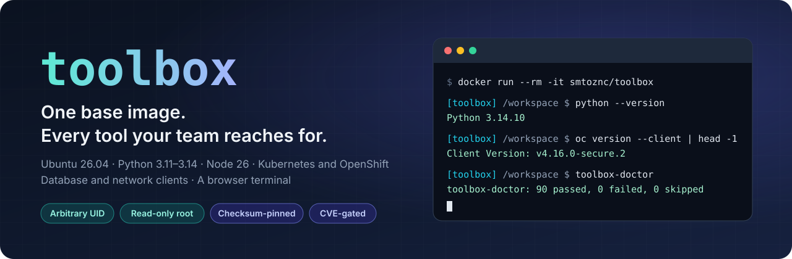
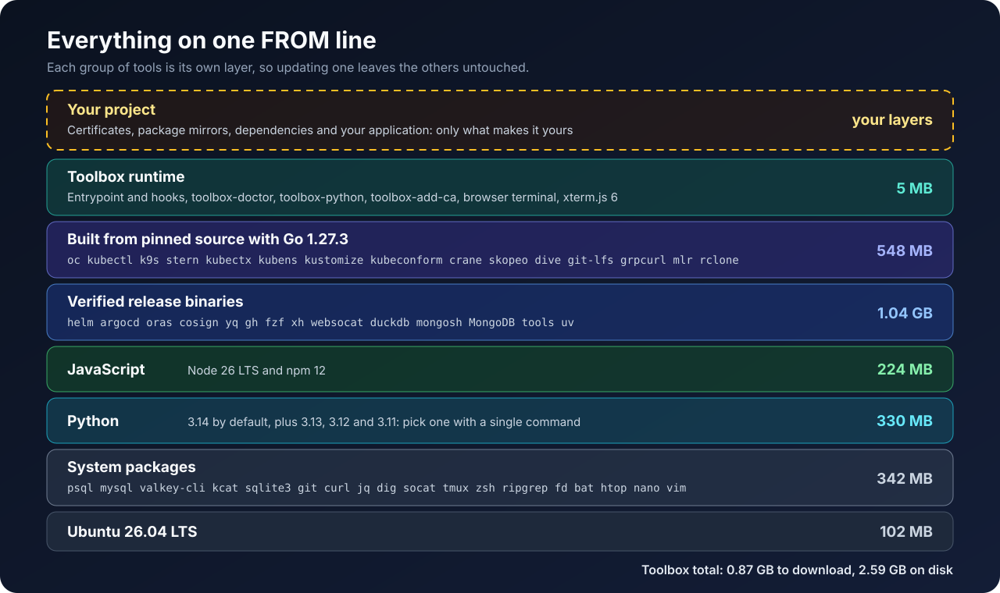
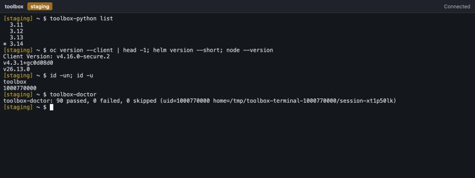
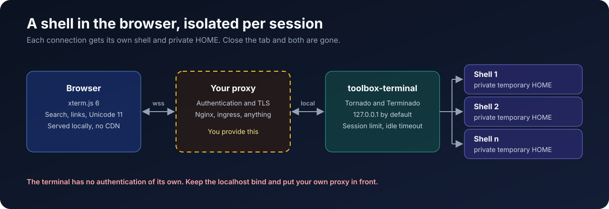
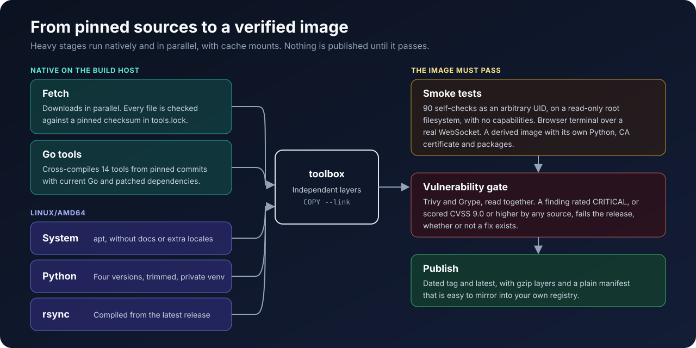

<p align="center">
  
</p>

<p align="center">
  <a href="https://hub.docker.com/r/smtoznc/toolbox"></a>
  
  
  
  
  
  <a href="LICENSE"></a>
</p>

<h3 align="center">Stop rewriting the same Dockerfile.</h3>

Every project ends up installing the same clients, the same CLIs and the same debugging tools,
one slow `RUN` line at a time. **toolbox** is a batteries-included Ubuntu base image that already
has them, runs cleanly on the most restrictive container platforms, and leaves your Dockerfile with
only the lines that are truly about your project.

```dockerfile
FROM smtoznc/toolbox:2026.11.06
COPY app/ /opt/app/
CMD ["python", "/opt/app/main.py"]
```

## ✨ Why toolbox

| What you get | Why it matters |
|---|---|
| 🧰 **Batteries included** | Four Python versions, Node, Kubernetes and OpenShift CLIs, database clients and network diagnostics, ready on the first line. |
| 🛡️ **At home on restricted platforms** | Runs as any arbitrary UID, on a read-only root filesystem, with every capability dropped. HOME and a user name are handled for you. |
| 🚦 **Gated against critical CVEs** | Trivy and Grype are read together, and any finding rated critical or scored CVSS 9.0 or higher stops a release. |
| 🔒 **Pinned and verified** | Everything outside Ubuntu's own signed packages is locked to a version with a checksum or a commit. Tools with vulnerable release binaries are rebuilt from source. |
| 🖥️ **A terminal in your browser** | xterm.js and Terminado are already inside, with an isolated shell and a private HOME for every connection. |
| 🧩 **Made to be built on** | Switch Python with one command, trust your CA with another, and hook into startup by dropping a script in a folder. |
| 🪶 **Lean for what it carries** | 0.87 GB to download, with package docs and unused translations stripped and no compiler toolchain. |

## 🚀 Quick start

Open a shell with everything in it:

```bash
docker run --rm -it smtoznc/toolbox
```

See every tool prove that it works, under the kind of restrictions OpenShift imposes:

```bash
docker run --rm --user 1000770000:0 --read-only --tmpfs /tmp --cap-drop ALL --security-opt no-new-privileges smtoznc/toolbox toolbox-doctor
```

Start the browser terminal, then open <http://127.0.0.1:8888/>:

```bash
docker run --rm -p 127.0.0.1:8888:8888 -e TOOLBOX_TERMINAL_BIND=0.0.0.0 smtoznc/toolbox toolbox-terminal
```

> On Apple Silicon, add `--platform linux/amd64`. The image is `linux/amd64` only.

## 📦 What's inside

<p align="center">
  
</p>

| Area | Tools |
|---|---|
| **Python** | 3.14 (default), 3.13, 3.12, 3.11, `pip`, `uv` |
| **JavaScript** | Node 26 LTS, `npm` 12 |
| **Kubernetes** | `oc` 4.16, `kubectl`, `helm`, `kustomize`, `k9s`, `stern`, `kubectx`, `kubens`, `argocd`, `kubeconform` |
| **Containers** | `skopeo`, `crane`, `oras`, `cosign`, `dive` |
| **Databases** | `psql`, `pg_dump`, `mysql`, `mysqldump`, `valkey-cli`, `mongosh`, MongoDB database tools, `kcat`, `sqlite3`, `duckdb` |
| **Data** | `jq`, `yq`, `mlr`, `xmlstarlet`, `rclone` |
| **Network** | `curl`, `wget`, `dig`, `ip`, `traceroute`, `mtr`, `socat`, `nc`, `grpcurl`, `websocat`, `xh` |
| **Shell** | `bash`, `zsh`, `tmux`, `nano`, `vim` (tiny), `fzf`, `rg`, `fd`, `bat`, `htop`, `ncdu`, `tree`, `rsync`, `parallel`, `less` |
| **Everything else** | `git`, `git-lfs`, `gh`, `openssl`, `zip`, `unzip`, `xz`, `zstd`, `file`, `envsubst` |

Exact versions of every tool and package are recorded in `/opt/toolbox/share/manifest.json`.

## 🧩 Build on it

A real project image stays this short:

```dockerfile
FROM smtoznc/toolbox:2026.11.06

USER root
COPY certs/ /tmp/certs/
RUN toolbox-add-ca /tmp/certs/*.crt && rm -rf /tmp/certs
RUN toolbox-python use 3.12
COPY requirements.txt /tmp/requirements.txt
RUN pip install -r /tmp/requirements.txt
COPY app/ /opt/app/

USER 1001:0
CMD ["python", "/opt/app/main.py"]
```

Pin by version or digest in production, and keep the entrypoint when you can: it prepares HOME, the
user name and extra certificates for arbitrary UIDs, then runs your command under `dumb-init`.

| Command | What it does |
|---|---|
| `toolbox-python list`, `current`, `use <version>` | Show or select the Python behind `python`, `python3` and `pip`. `use` needs root. |
| `toolbox-add-ca <file>...` | Trust extra CA certificates for the system, Python, pip, uv and Node. Needs root. |
| `toolbox-terminal` | Start the browser terminal. |
| `toolbox-doctor [-v]` | Check that every tool works for the current user. |

| Location | What it's for |
|---|---|
| `/opt/toolbox/entrypoint.d/*.sh` | Sourced by the entrypoint, in order. Add your own startup steps here. |
| `/etc/toolbox/ca.d/*.crt` | Certificates mounted at run time are added to the trust bundle. |
| `/workspace` | Default working directory, writable by arbitrary UIDs in group 0. |

## 🖥️ Browser terminal

<p align="center">
  
</p>

Every WebSocket connection gets its own shell and a private temporary HOME, and both disappear when the
connection closes. All assets are served from the image, so it works with no CDN and no internet access.

<p align="center">
  
</p>

> [!WARNING]
> **The terminal has no authentication of its own.** Anyone who reaches it gets a shell with the
> container's permissions. Keep the default localhost bind and put an authenticating reverse proxy in front.

| Variable | Default | Purpose |
|---|---|---|
| `TOOLBOX_TERMINAL_BIND` | `127.0.0.1` | Listen address |
| `TOOLBOX_TERMINAL_PORT` | `8888` | Listen port |
| `TOOLBOX_TERMINAL_PREFIX` | none | URL prefix, for example `/console` |
| `TOOLBOX_TERMINAL_TITLE` | `Toolbox` | Page title |
| `TOOLBOX_TERMINAL_SHELL` | `/bin/bash` | Shell to start |
| `TOOLBOX_TERMINAL_MAX_SESSIONS` | `16` | Concurrent sessions |
| `TOOLBOX_TERMINAL_IDLE_SECONDS` | `0` | Close sessions without input for this long; `0` disables it |
| `TOOLBOX_TERMINAL_EPHEMERAL_HOME` | `true` | Give each session its own temporary HOME |
| `TOOLBOX_ENV_LABEL` | none | Environment label in the header and prompt |
| `TOOLBOX_ENV_TONE` | `neutral` | Label color: `neutral`, `warning` or `danger` |

Liveness and readiness probes can use `/healthz`.

## 🚦 Security

Most base images leave vulnerability triage to you. toolbox treats it as part of the build: `scripts/scan.sh`
runs Trivy and Grype, and `scripts/cve_gate.py` fails when either one rates a finding CRITICAL or any source
scores it CVSS 9.0 or higher, **whether or not a fix exists**.

Here is what that discipline changed, compared with the first build from upstream release binaries and stock packages:

| Trivy and Grype combined | First build | `2026.11.06` |
|---|---:|---:|
| Findings rated critical or scored CVSS 9.0+ | 122 | **0** ¹ |
| Findings of any severity ² | 3,025 | **613** |
| Size on disk | 2.91 GB | **2.59 GB** |

<sub>¹ One finding is allowlisted: CVE-2026-118131 in `gpgv` only affects GnuPG for Windows. `apt` requires this package and every `ubuntu:26.04` image reports it. See `scripts/cve-allowlist.txt`.<br>
² Counted per scanner, so a finding reported by both counts twice. Scanned on 2026-11-06.</sub>

How it got there:

- **14 Go tools rebuilt** from pinned commits with Go 1.27.3 and patched dependencies, instead of shipping release binaries with older ones.
- **`oc` 4.16 rebuilt** on upgraded `buildkit`, `docker`, `containers/image` and `go-git`, with a [small patch](build/patches/oc.sh) for the API changes.
- **`rsync` compiled** from the latest upstream release, because Ubuntu's package has unpatched critical findings.
- **`mysql-client` instead of MariaDB's**, for the same reason.
- **No compiler toolchain**, because `linux-libc-dev` reports unpatched critical kernel CVEs.
- **`npm` upgraded** past the version bundled with Node.

> [!NOTE]
> This table is a snapshot, not a promise. Scanner databases change daily, other scanners use other data, lower-severity
> findings remain, and these scanners do not inspect the Node runtime bundled inside `mongosh`. Run your own scanner
> before production, and rebuild to pick up new fixes.

## 🏗️ How it's built

<p align="center">
  
</p>

Build it yourself:

```bash
docker buildx create --name toolbox --driver docker-container --bootstrap
```

```bash
VERSION=dev docker buildx bake --builder toolbox default
```

```bash
tests/smoke.sh smtoznc/toolbox:dev
```

```bash
scripts/scan.sh smtoznc/toolbox:dev
```

Leave out what you don't need by name, from `build/tools.lock`, `build/go-tools.lock` or `build/apt-packages.txt`.
Keep the base packages at the top of `build/apt-packages.txt`.

```bash
VERSION=dev docker buildx bake --builder toolbox --set '*.args.TOOLBOX_EXCLUDE=k9s,duckdb' default
```

Downloads and Go builds run natively, so only the apt, Python and rsync steps are emulated on an arm64 machine.

To publish from a fork, add the `DOCKERHUB_USERNAME` and `DOCKERHUB_TOKEN` repository secrets and start the `build`
workflow by hand from the Actions tab. It builds, tests and scans the image, and only pushes if all of that passes.
Nothing runs on a schedule, so rerun it when you want the latest Ubuntu security updates, and bump the lock files
when you want newer tools.

## 💡 Good to know

- **`linux/amd64` only** for now.
- **No C compiler.** To build native code, install `build-essential` in a builder stage of your own image and copy out the result.
- **`oc` is an unofficial build:** OpenShift's 4.16 source with newer dependencies, not a Red Hat release. Test it against your own cluster before relying on it.

## 📄 License

The files in this repository are under the [Apache License 2.0](LICENSE). The image also contains third-party software
under its own licences: see [THIRD_PARTY_NOTICES.md](THIRD_PARTY_NOTICES.md).
