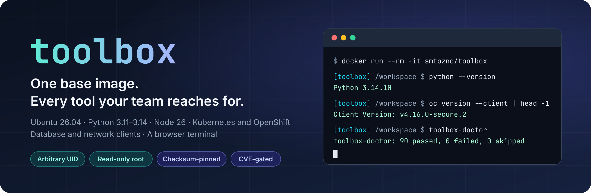
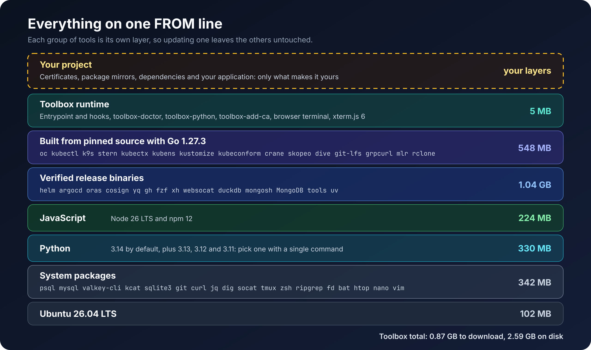
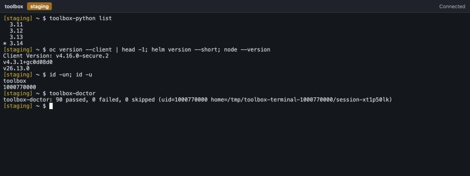
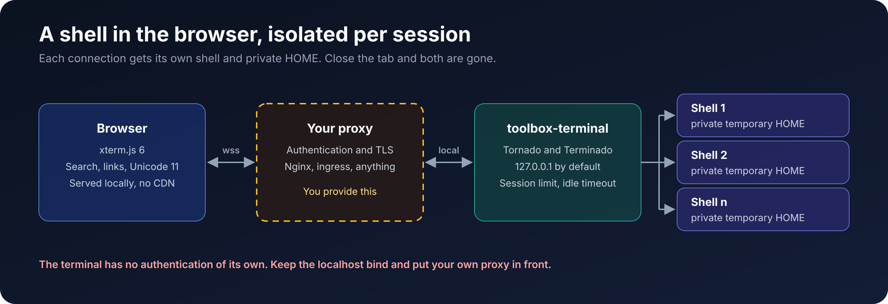

# Stop rewriting the same Dockerfile.

Every project ends up installing the same clients, the same CLIs and the same debugging tools, one slow `RUN` line at a time. **toolbox** is a batteries-included Ubuntu base image that already has them, runs cleanly on the most restrictive container platforms, and leaves your Dockerfile with only the lines that are truly about your project.

```dockerfile
FROM smtoznc/toolbox:2026.11.06
COPY app/ /opt/app/
CMD ["python", "/opt/app/main.py"]
```

**Source, docs and issues:** [github.com/ozncv2/toolbox](https://github.com/ozncv2/toolbox) · **Maintainer:** [Samet Özenç](https://www.linkedin.com/in/samet-ozenc/)

## ✨ Why toolbox

- 🧰 **Batteries included.** Four Python versions, Node, Kubernetes and OpenShift CLIs, database clients and network diagnostics, ready on the first line.
- 🛡️ **At home on restricted platforms.** Runs as any arbitrary UID, on a read-only root filesystem, with every capability dropped.
- 🚦 **Gated against critical CVEs.** Trivy and Grype are read together, and any finding rated critical or scored CVSS 9.0 or higher stops a release.
- 🔒 **Pinned and verified.** Everything outside Ubuntu's own signed packages is locked to a version with a checksum or a commit. Tools with vulnerable release binaries are rebuilt from source.
- 🖥️ **A terminal in your browser.** xterm.js and Terminado are already inside, with an isolated shell and a private HOME for every connection.
- 🧩 **Made to be built on.** Switch Python with one command, trust your CA with another, and hook into startup by dropping a script in a folder.
- 🪶 **Lean for what it carries.** 0.87 GB to download, with package docs and unused translations stripped and no compiler toolchain.

## 🚀 Quick start

Open a shell with everything in it:

```bash
docker run --rm -it smtoznc/toolbox
```

See every tool prove that it works, under the kind of restrictions OpenShift imposes:

```bash
docker run --rm --user 1000770000:0 --read-only --tmpfs /tmp --cap-drop ALL --security-opt no-new-privileges smtoznc/toolbox toolbox-doctor
```

Start the browser terminal, then open `http://127.0.0.1:8888/`:

```bash
docker run --rm -p 127.0.0.1:8888:8888 -e TOOLBOX_TERMINAL_BIND=0.0.0.0 smtoznc/toolbox toolbox-terminal
```

On Apple Silicon, add `--platform linux/amd64`. The image is `linux/amd64` only.

## 🏷️ Tags

| Tag | Digest |
|---|---|
| `2026.11.09`, `latest` | `sha256:4e274c8d0ef7c51c70ffa0b3e9cd1ab1262bb2d108eb09e1e46471f9b75c1790` |
| `2026.11.10-lite`, `lite` | `sha256:3418beec2461be30359e98750aa00cf1a58638083d91534b5a1ef46d2126daba` |
| `2026.11.06` | `sha256:98efe3289fca77f985ce08acba725bbacf14719e8de416e4240a7ebd8f5f1431` |

Pin a dated tag or a digest in production. `latest` and `lite` move with every release. The lite variant keeps the
Kubernetes and OpenShift clients, the shell, network and database clients from Ubuntu, and Python 3.14 with the
browser terminal, at about a third of the size. See the README for what it leaves out.

## 📦 What's inside



| Area | Tools |
|---|---|
| **Python** | 3.14 (default), 3.13, 3.12, 3.11, `pip`, `uv` |
| **JavaScript** | Node 26 LTS, `npm` 12 |
| **Kubernetes** | `oc` 4.16, `kubectl`, `helm`, `kustomize`, `k9s`, `stern`, `kubectx`, `kubens`, `argocd`, `kubeconform` |
| **Containers** | `skopeo`, `crane`, `oras`, `cosign`, `dive` |
| **Databases** | `psql`, `pg_dump`, `mysql`, `mysqldump`, `valkey-cli`, `mongosh`, MongoDB database tools, `kcat`, `sqlite3`, `duckdb` |
| **Data** | `jq`, `yq`, `mlr`, `xmlstarlet`, `rclone` |
| **Network** | `curl`, `wget`, `dig`, `ip`, `traceroute`, `mtr`, `socat`, `nc`, `grpcurl`, `websocat`, `xh` |
| **Shell** | `bash`, `zsh`, `tmux`, `nano`, `vim` (tiny), `fzf`, `rg`, `fd`, `bat`, `htop`, `ncdu`, `tree`, `rsync`, `parallel`, `less` |
| **Everything else** | `git`, `git-lfs`, `gh`, `openssl`, `zip`, `unzip`, `xz`, `zstd`, `file`, `envsubst` |

## 🧩 Build on it

```dockerfile
FROM smtoznc/toolbox:2026.11.06

USER root
COPY certs/ /tmp/certs/
RUN toolbox-add-ca /tmp/certs/*.crt && rm -rf /tmp/certs
RUN toolbox-python use 3.12
COPY requirements.txt /tmp/requirements.txt
RUN pip install -r /tmp/requirements.txt
COPY app/ /opt/app/

USER 1001:0
CMD ["python", "/opt/app/main.py"]
```

| Command | What it does |
|---|---|
| `toolbox-python list`, `current`, `use <version>` | Show or select the Python behind `python`, `python3` and `pip`. `use` needs root. |
| `toolbox-add-ca <file>...` | Trust extra CA certificates for the system, Python, pip, uv and Node. Needs root. |
| `toolbox-terminal` | Start the browser terminal. |
| `toolbox-doctor [-v]` | Check that every tool works for the current user. |

## 🖥️ Browser terminal



Every WebSocket connection gets its own shell and a private temporary HOME, and both disappear when the connection closes. All assets are served from the image, so it works with no CDN and no internet access.



**⚠️ The terminal has no authentication of its own.** Anyone who reaches it gets a shell with the container's permissions. Keep the default localhost bind and put an authenticating reverse proxy in front. All settings are in the [README](https://github.com/ozncv2/toolbox#readme).

## 🚦 Security

A finding rated CRITICAL by Trivy or Grype, or scored CVSS 9.0 or higher by any source, fails the gate, whether or not a fix exists.

| Trivy and Grype combined | First build | `2026.11.06` |
|---|---:|---:|
| Findings rated critical or scored CVSS 9.0+ | 122 | **0** ¹ |
| Findings of any severity ² | 3,025 | **613** |

¹ One finding is allowlisted: CVE-2026-118131 in `gpgv` only affects GnuPG for Windows. `apt` requires this package and every `ubuntu:26.04` image reports it.

² Counted per scanner, so a finding reported by both counts twice. Scanned on 2026-11-06.

This table is a snapshot, not a promise. Scanner databases change daily, other scanners use other data, lower-severity findings remain, and these scanners do not inspect the Node runtime bundled inside `mongosh`. Run your own scanner before production.

## 💡 Good to know

- **`linux/amd64` only** for now.
- **No C compiler.** To build native code, install `build-essential` in a builder stage of your own image and copy out the result.
- **`oc` is an unofficial build:** OpenShift's 4.16 source with newer dependencies, not a Red Hat release. Test it against your own cluster before relying on it.

## 👋 About the maintainer

Built and maintained by **Samet Özenç**, a Machine Learning Engineer in Istanbul working on MLOps, AI architecture and Kubernetes. Questions, ideas and feedback are always welcome: [connect on LinkedIn](https://www.linkedin.com/in/samet-ozenc/).

## 📄 License

Apache License 2.0 for the [repository](https://github.com/ozncv2/toolbox). The image also contains third-party software under its own licences, listed in `/opt/toolbox/share/THIRD_PARTY_NOTICES.md` and `/opt/toolbox/share/licenses/`.
